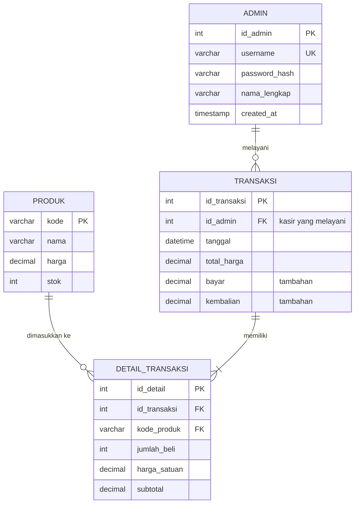

# ERD — Sistem Kasir Toko

**Perbedaan dari ERD awal:**

| Perubahan | Alasan |
|---|---|
| Tabel `admin` | Dibutuhkan fitur login dengan `password_hash()` / `password_verify()` |
| Kolom `transaksi.id_admin` (FK → `admin`) | Mencatat kasir yang melayani; tampil di struk dan riwayat, sekaligus menghubungkan `admin` dengan tabel lain |
| Kolom `transaksi.bayar` dan `transaksi.kembalian` | Struk perlu menampilkan uang diterima dan kembalian |
| `UNIQUE (id_transaksi, kode_produk)` pada detail | Satu produk hanya satu baris per transaksi; jumlah digabung |
| `CHECK (stok >= 0)`, `CHECK (jumlah_beli > 0)`, dan `CHECK (total_harga, bayar, kembalian >= 0)` | Lapisan pengaman terakhir di level database |

**Aturan relasi**
- `transaksi.id_admin → admin` : `ON DELETE RESTRICT` (admin yang sudah punya transaksi tidak bisa dihapus, agar riwayat kasir tetap utuh)
- `detail_transaksi.id_transaksi → transaksi` : `ON DELETE CASCADE`
- `detail_transaksi.kode_produk → produk` : `ON DELETE RESTRICT` (produk yang sudah terjual tidak bisa dihapus, agar riwayat tetap utuh)
