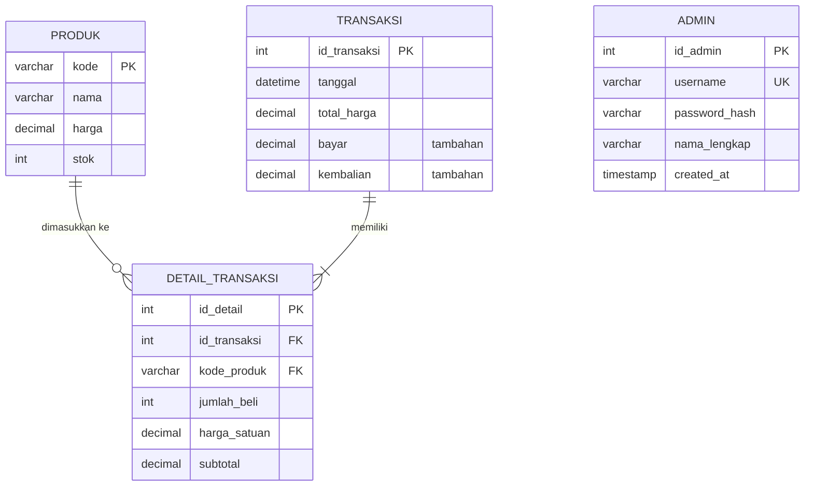

# ERD — Sistem Kasir Toko

**Perbedaan dari ERD awal (tiga tabel inti tidak berubah):**

| Perubahan | Alasan |
|---|---|
| Tabel `admin` (berdiri sendiri, tanpa relasi) | Dibutuhkan fitur login dengan `password_hash()` / `password_verify()` |
| Kolom `transaksi.bayar` dan `transaksi.kembalian` | Struk perlu menampilkan uang diterima dan kembalian |
| `UNIQUE (id_transaksi, kode_produk)` pada detail | Satu produk hanya satu baris per transaksi; jumlah digabung |
| `CHECK (stok >= 0)` dan `CHECK (jumlah_beli > 0)` | Lapisan pengaman terakhir di level database |

**Aturan relasi**
- `detail_transaksi.id_transaksi → transaksi` : `ON DELETE CASCADE`
- `detail_transaksi.kode_produk → produk` : `ON DELETE RESTRICT` (produk yang sudah terjual tidak bisa dihapus, agar riwayat tetap utuh)
